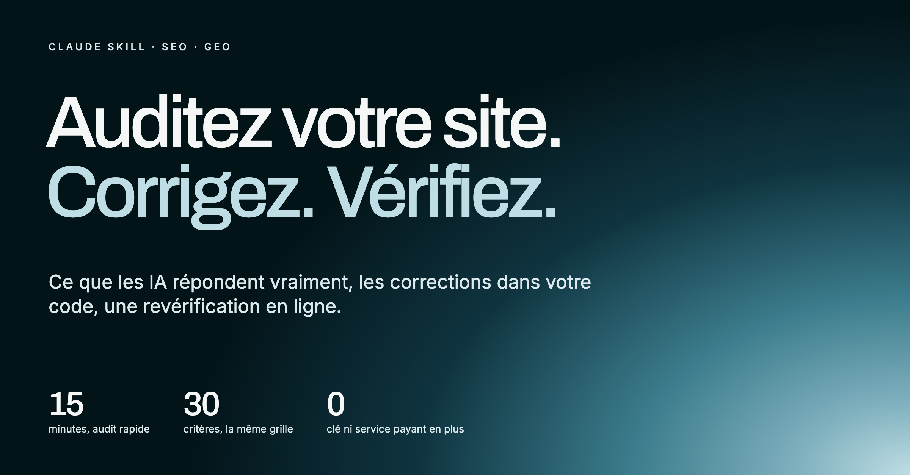
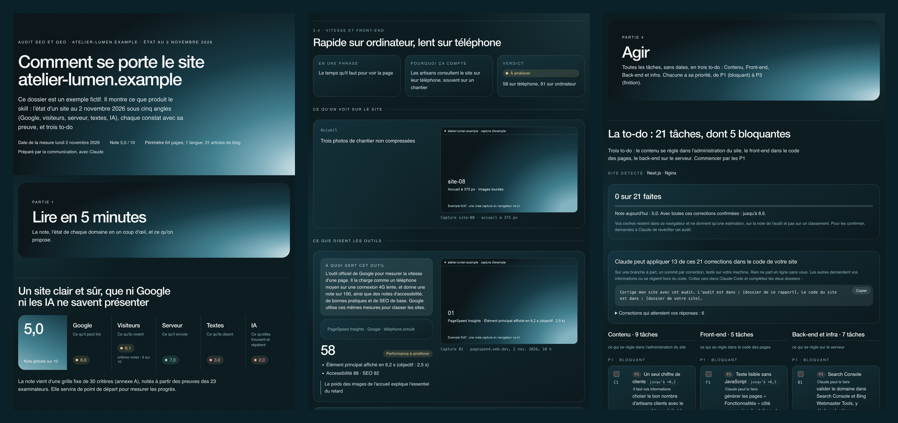

<p align="center"></p>

# audit-seo-geo

**Le skill Claude qui audite n'importe quel site à 360° : ce que Google peut lire, ce que vivent les visiteurs, ce que fait le serveur, ce que disent les textes et ce que répondent les IA. Chaque constat a sa preuve, chaque problème devient une tâche, rangée dans la bonne to-do : contenu, front-end ou back-end. Puis, si vous le voulez, il applique les corrections dans votre code sur une branche, et vérifie sur le site en ligne ce qui tient.**

[Voir la page du projet](https://tania-bezancon.github.io/audit-seo-geo/fr/) · [Ouvrir un audit d'exemple](https://tania-bezancon.github.io/audit-seo-geo/demo/fr/) · [English](README.md)

**Installation, à taper dans une conversation Claude Code, pas dans le terminal :**

```
/plugin marketplace add Tania-bezancon/audit-seo-geo
/plugin install audit-seo-geo@tania-bezancon
```

Puis `/audit-seo-geo:audit-seo-geo quick <url>`, ou demandez-le simplement avec vos mots (« fais un audit SEO rapide de mon site »). Vous recevez une page web, publiée en artifact Claude privé que vous partagez quand vous voulez (ou un simple fichier), et la to-do. Si vous avez le code du site, dites ensuite « corrige mon site avec cet audit » : Claude applique ce qu'il peut sur une branche à part, vous demande ce qu'il ne doit pas inventer, et rien ne part en ligne sans vous. Une fois le site publié, demandez-lui de revérifier.

## Pour qui

Les freelances qui s'occupent du site de leurs clients, les équipes marketing et communication, les dirigeants. Pas besoin d'être développeur, et presque rien à installer.

Il commence par vous poser quelques questions : à qui est le site, ce qu'il doit rapporter, qui fera les changements, ce que vous voulez recevoir. Après les premières mesures, il ne demande que ce que le site ne dit pas : votre offre et ce qui la rend meilleure, les concurrents auxquels on vous compare, un fait trouvé en deux versions. « Je ne sais pas » est une bonne réponse : ce qui ne peut pas être vérifié est noté comme tel, jamais deviné. Les tâches sont ensuite écrites pour la personne qui les fera : où cliquer dans l'administration du site, ou le code pour un développeur.

## Deux audits : rapide ou détaillé

Commencez par l'audit rapide pour savoir où en est le site. Passez à l'audit détaillé quand il vous faut des preuves à présenter. Les rapports suivent la langue dans laquelle vous écrivez, français ou anglais.

| | Rapide | Détaillé |
|---|---|---|
| À demander | `quick <url>` | `full <url>` |
| Durée | environ 15 minutes | une journée de travail |
| Navigateur | facultatif | nécessaire |
| Pages | jusqu'à 25 | toutes, jusqu'à 400 |
| Critères vérifiés | environ 15 à 22 sur 30 | 30 |
| Preuves | mesures et liens | une capture datée par constat |
| Panel d'IA | 3 questions, 2 assistants, si un navigateur est disponible | 5 questions, 4 assistants |
| Ce que vous obtenez | une page web et la to-do | une page web, la to-do et un protocole de remesure ; un PDF et un PowerPoint si vous les demandez |
| Note | provisoire, pour un premier regard | comparable d'un audit à l'autre |
| Suivi | `compare.py` entre deux audits rapides | `compare.py` entre deux audits détaillés, avec le protocole |

[Voir un audit rapide](https://tania-bezancon.github.io/audit-seo-geo/demo/quick/) (en anglais) ou la [procédure](references/quick-mode.md).

### Pour aller plus loin : l'audit détaillé

L'audit rapide vous dit l'essentiel en quelques minutes. L'audit détaillé est celui que vous montrez à un client ou à une direction : une capture datée pour chaque constat, le panel d'IA complet, les 30 critères, et un rapport à partager en page web, avec un PDF ou un PowerPoint prêts à présenter si vous les demandez.

```
/audit-seo-geo:audit-seo-geo full https://www.votre-site.com
```

Ou demandez-le avec vos mots : « fais un audit SEO détaillé de mon site ». Il prend une journée de travail et demande un navigateur piloté par Claude. [Voir un exemple](https://tania-bezancon.github.io/audit-seo-geo/demo/fr/). Comparez un audit détaillé avec un autre audit détaillé : une note rapide et une note détaillée ne reposent pas sur les mêmes preuves.


**Un rapport qui se comprend d'un coup d'œil.** Il s'ouvre sur cinq regards avec un feu chacun et les trois tâches par lesquelles commencer. Il montre ensuite le site vu de dehors : son résultat Google, ce qu'on voit quand on le partage, et ce que voit un visiteur à côté de ce que lit un robot d'IA sans JavaScript. Le panel dit qui est cité à la place du site, et combien de fois.

**Il peut appliquer les corrections dans votre code.** Dites « corrige mon site » et donnez le dossier du code. Chaque tâche est classée : Claude peut le faire, il faut vos informations, ou cela se règle hors du code. Celles qui ont besoin de vous arrivent avec leurs questions, et un formulaire à remplir et à coller. Claude travaille sur une branche à part, avec un commit par tâche, et refuse d'inventer une raison sociale ou un chiffre. Il construit le site, le relit sur votre machine avant et après, et s'arrête si ce qui marchait marche moins bien. Il ne peut ni envoyer ni publier : vous relisez la branche, vous la mettez en ligne, et `quick.py check` confirme ensuite ce qui tient sur le site en ligne.

**Des corrections faciles à appliquer.** Chaque tâche dit où agir et quoi coller, pour la plateforme du site, que le relevé détecte (Next.js, WordPress, Webflow, Shopify, Netlify, Vercel, Nginx…). Le rapport montre la vraie page avant et après, donne le code à copier et écrit des fichiers prêts dans `fixes/` : les en-têtes de sécurité manquants, un `llms.txt`, un bloc Organization, un tableau des titles à corriger. Ce sont des brouillons à relire, et rien n'est jamais appliqué au site.

**Le suivi des corrections.** Chaque correction montre ce qu'elle peut apporter sur la note de l'audit. Cochez ce qui est fait : la page s'en souvient dans votre navigateur et estime la note, en le disant bien. Demandez ensuite à Claude de revérifier : `quick.py check` relit le site et indique sur chaque carte ce qui est confirmé corrigé, mieux ou pas encore, sans toucher à la note de l'audit.

**Ce qui a vraiment changé.** `python3 scripts/compare.py ancien/audit.json nouveau/audit.json` compare deux audits d'un site : la note sur les seuls critères vérifiés les deux fois, ce qui s'améliore, ce qui se dégrade, les outils lus avec les seuils de bruit, les réponses des IA et les tâches encore ouvertes ([exemple en anglais](https://tania-bezancon.github.io/audit-seo-geo/demo/compare/)).

---

## Pourquoi un audit de plus

La plupart des audits SEO se ressemblent : un score tiré d'un seul outil, cinquante recommandations génériques, un calendrier que personne ne tient. Trois mois plus tard, on refait l'audit avec un autre outil, la note a changé, et personne ne sait si le site s'est amélioré ou si on a juste mesuré autrement.

Deux questions restent souvent sans réponse :
- **qui doit faire quoi ?** Une liste de 50 points mélange ce que la communication règle en dix minutes dans le CMS et ce qui demande une journée de développeur ;
- **est-ce que les IA nous citent ?** Les acheteurs posent leurs questions à ChatGPT ou à Perplexity avant Google, et beaucoup de sites modernes leur sont invisibles parce que leur texte arrive par JavaScript.

Ce skill répond aux deux.

## Ce qui en fait un audit à 360°

### 1. Cinq regards, 23 examinateurs gratuits
Pas une API payante, pas un score maison opaque : n'importe qui peut refaire la mesure à la même adresse.

| Regard | Ce qu'on vérifie | Avec quoi |
|---|---|---|
| **Google** | robots.txt, sitemap, redirections, fausses 404, canonicals, hreflang, rendu sans JavaScript | relevé automatique, recherche « site: », Bing, test des résultats enrichis, Schema Markup Validator |
| **Visiteurs** | Core Web Vitals, téléphone, accessibilité, appel à l'action, formulaire, preuves | PageSpeed Insights (téléphone et ordinateur), WAVE, validateur W3C |
| **Serveur** | temps de réponse, compression, cache, TLS, en-têtes de sécurité, traceurs | relevé automatique, SSL Labs, Security Headers, Mozilla Observatory, Internet.nl, Webbkoll, Blacklight |
| **Textes** | titles, descriptions, aperçus de partage, fautes, faits contradictoires, fraîcheur | relevé automatique, LanguageTool, OpenGraph.xyz |
| **IA** | qui est cité à votre place, quels faits faux circulent, robots des IA, llms.txt, entité | ChatGPT, Google Mode IA, Brave, Perplexity (sans compte), Wikidata, Ahrefs, Similarweb |

Le relevé automatique (`crawl.py`) lit chaque page comme le fait un robot d'IA, sans JavaScript, et signale les pages presque vides : c'est souvent le problème le plus grave d'un site récent.

### 2. Une note qui se compare
La grille est **fixe** : 6 catégories × 5 critères, chacun noté 0, 1 ou 2. Mêmes outils, mêmes réglages, mêmes questions aux IA à chaque audit. Quand la note bouge, c'est le site qui a bougé, pas la méthode.

| | Catégorie | Ce qu'on regarde |
|---|---|---|
| A | Exploration et indexation | accès des robots, une seule version du site, codes HTTP, rendu sans JavaScript, architecture |
| B | Performance et front-end | LCP, INP et CLS réels, PageSpeed téléphone, images, JavaScript et CSS, mobile |
| C | Serveur, sécurité et vie privée | TLS et HSTS, en-têtes de sécurité, compression et cache, temps de réponse, consentement |
| D | Contenus et SEO éditorial | titles, descriptions et partage, structure, profondeur, justesse des faits, fraîcheur et langues |
| E | Expérience, accessibilité et conversion | les 5 premières secondes, appel à l'action, formulaire, preuves, WCAG |
| F | GEO et autorité | données structurées, robots des IA et llms.txt, entité, contenus citables, présence dans les réponses |

Un critère invérifiable (sans Search Console, par exemple) est noté **NV** et retiré du calcul, au lieu d'être deviné.

### 3. Trois to-do, zéro calendrier
Chaque problème devient une tâche précise, avec la correction et un « Vérifié quand… » que n'importe qui peut refaire. Elle va dans la to-do de la personne qui peut la faire :

- **Contenu** (`C1`, `C2`…) : ce qui se règle dans l'administration du site, sans développeur ;
- **Front-end** (`F1`…) : ce qui se règle dans le code des pages ;
- **Back-end et infra** (`B1`…) : ce qui se règle sur le serveur.

Chaque tâche a sa priorité : **P1** bloquant, **P2** important, **P3** finition. Aucune date, aucun délai, aucun effort en jours. La to-do sort aussi en **Markdown** (à cocher, à coller dans un ticket) et en **CSV** (à importer dans Notion, Jira, Linear, Trello ou GitHub Projects).

La [checklist 360°](references/checklist-360.md) donne, pour plus de 60 contrôles, la preuve attendue, la correction type, la priorité par défaut et le critère touché.

### 4. Le GEO mesuré, pas promis
Le panel IA pose **5 questions fixes** à 4 assistants : 4 questions de marché (celles qu'un acheteur pose sans connaître la marque) et 1 question de marque (« Qu'est-ce que X ? »). On note qui est cité à votre place, et chaque chiffre faux que les IA répètent sur vous. À la remesure, chaque question est posée 3 fois : une citation ne compte que si elle revient 2 fois sur 3.

### 5. Une preuve pour chaque constat
Chaque constat est rangé **vérifié**, **hypothèse** ou **non vérifiable**. Un constat vérifié a sa capture réelle, prise le jour de la mesure, avec un cadre rouge sur le défaut, ou son lien. Aucune statistique inventée, aucune position Google supposée, aucune promesse de classement.

### 6. Un dossier qu'on a envie de lire
Tout part d'un seul fichier, `audit.json`. Les scripts en tirent :
- un **dossier HTML** en 5 parties (lire en 5 minutes, comprendre la mesure, 9 domaines, agir, suivre) et ses annexes ;
- son **PDF A4** et une **page unique** (un seul fichier, captures intégrées, à envoyer par mail) ;
- la **to-do** en Markdown et en CSV ;
- un **PowerPoint 16:9** d'une centaine de slides aux couleurs de la marque.



### 7. Il se contrôle tout seul
Avant de produire quoi que ce soit, `build_dossier.py` s'arrête si une tâche est citée sans exister ou existe sans être citée, si une tâche n'a pas de voie ou de priorité valide, s'il manque un critère, ou **si une note ne correspond pas aux critères** : il recalcule chaque catégorie et la note globale. Il signale aussi tout nom de concurrent resté dans le texte. `scripts/selftest.sh` fabrique l'exemple dans les deux langues, lance l'audit rapide sur un site de test local et vérifie chaque sortie.

### 8. Il respecte les sites qu'il audite
Le relevé laisse 3 secondes entre deux requêtes et reprend là où il s'est arrêté. Un audit ne modifie jamais le site, ne remplit aucun formulaire réel, ne coche jamais une case « je suis humain » et ne capture jamais un espace connecté.

## Installation

**En plugin** (recommandé), dans Claude Code :

```
/plugin marketplace add Tania-bezancon/audit-seo-geo
/plugin install audit-seo-geo@tania-bezancon
```

Ou depuis le terminal :

```bash
claude plugin marketplace add Tania-bezancon/audit-seo-geo
claude plugin install audit-seo-geo@tania-bezancon
```

Puis, dans Claude Code :

```
/audit-seo-geo:audit-seo-geo full https://www.votre-site.fr
```

**En simple dossier de skill**, si vous préférez. La commande est alors la plus courte `/audit-seo-geo full <url>` :

```bash
git clone https://github.com/Tania-bezancon/audit-seo-geo.git ~/.claude/skills/audit-seo-geo
```

Vos sites, thèmes, polices et logos restent dans `~/.claude/audit-seo-geo/`, et vos audits vont dans `audits/<domaine>/<date>/` sous le dossier courant : les mises à jour n'y touchent pas. 

Le skill se déclenche aussi tout seul quand on demande « un audit SEO », « notre visibilité dans les IA », « la liste des corrections front et back », « refais l'audit pour voir les progrès »…

### Ce qu'il faut sur la machine

| | Pour quoi | |
|---|---|---|
| Claude Code | fait tourner le skill | obligatoire |
| Python 3.9+ | relevé, rapport, to-do. Déjà présent sur Mac avec les outils de développement ; [python.org](https://www.python.org/downloads/) sous Windows | obligatoire |
| Un navigateur que Claude pilote : l'extension Claude in Chrome, ou le navigateur intégré à l'application Claude | captures des outils et des réponses des IA | pour l'audit détaillé ; en rapide, pour le panel d'IA |
| Google Chrome | le PDF ; la vitesse mesurée sur votre machine quand PageSpeed refuse | seulement si vous les voulez |
| Node.js 18+ | le PowerPoint (Claude lance `scripts/setup_pptx.sh` la première fois) ; la vitesse mesurée sur votre machine | seulement si vous les voulez |
| Pillow (`pip install pillow`) | les cadres rouges sur les captures | facultatif |

Claude n'installe rien de lui-même : il dit ce qu'une option demande, et vous choisissez.

## Essayer sans rien auditer

L'exemple fictif d'Atelier Lumen (un site en `.example`, des captures factices) produit tout en quelques secondes, en français dans `fr/` et en anglais dans `en/` :

```bash
scripts/selftest.sh /tmp/audit-exemple
open /tmp/audit-exemple/fr/index.html
```

Ou directement en ligne : [l'audit d'exemple](https://tania-bezancon.github.io/audit-seo-geo/demo/fr/).

## Comment se déroule un audit

Une journée de travail, annoncée au début :

1. **Quelques questions** ([references/intake.md](references/intake.md)) : à qui est le site, son objectif, qui fera les changements, ce que vous voulez recevoir ; puis, après les premières mesures, l'offre, les concurrents et les faits à confirmer. Rien à redemander pour un site déjà dans `~/.claude/audit-seo-geo/sites.json`.
2. **Les mesures** (environ 3 h) : relevé automatique en arrière-plan, le rendu sans JavaScript, les 19 outils avec leur capture numérotée, le panel des IA, les captures du site, la checklist 360°.
3. **La note** (environ 2 h) : les 30 critères avec leur preuve, les 9 domaines, les tâches des trois to-do.
4. **La fabrication** (environ 1 h) : la page web et la to-do, plus le PDF et le PowerPoint si vous les avez demandés, puis contrôle à 1 280 et 375 px.
5. **Le protocole de remesure** : le seul document daté, pour refaire exactement la même mesure dans 1, 3 ou 6 mois.

## Ce que contient le dépôt

```
.claude-plugin/          le manifeste du plugin et sa marketplace
SKILL.md                 la méthode : contexte, preuve, mesures, grille, tâches, livrables, contrôles
references/
  quick-mode.md          l'audit rapide, étape par étape
  checklist-360.md       plus de 60 contrôles, voie par voie, avec correction type et priorité
  tools.md               les 19 outils : adresse, réglage, ce qu'on relève, seuils des feux
  ai-panel.md            les 5 questions et les 4 IA : écrire, poser, noter
  screenshots.md         ranger, nommer et encadrer les captures
  data-format.md         le format de audit.json
assets/
  ui.json                les textes fixes des rapports, par langue
  defaults.<lang>.json   grille, voies, priorités, outils, lexique, règles de remesure, domaines
  themes.json            couleurs et police par marque (signature, neutre, les vôtres)
  sites.json             le format de votre liste de sites connus
  quick.json             le mode rapide : critères, preuves, tâches par défaut, par langue
  example/               l'audit fictif d'Atelier Lumen, en anglais et en français
scripts/
  quick.py               l'audit rapide : measure, puis build
  compare.py             ce qui a changé entre deux audits
  fixes.py               la plateforme détectée, et les fichiers prêts à adapter
  crawl.py               relevé des pages, du serveur et des robots des IA, lent et reprenable
  lt.py                  fautes avec LanguageTool, page par page
  annotate.py            cadres rouges sur une capture
  build_dossier.py       audit.json → HTML, PDF, page unique, to-do .md et .csv (après contrôles)
  build_pptx.js          audit.json → PowerPoint
  render_pptx_pdf.sh     PowerPoint → PDF et planches de contrôle
  selftest.sh            l'exemple et l'audit rapide de bout en bout, hors ligne
docs/                    la page du projet et la démo en ligne
```

## Ajouter sa marque

Créer `~/.claude/audit-seo-geo/themes.json`, y copier sous un nouveau nom le thème `signature` de `assets/themes.json`, changer les couleurs, et mettre ce nom dans `site.theme`. Une police va dans `~/.claude/audit-seo-geo/fonts/` (listée dans `font.files`) et sera intégrée à la page unique : prenez-la sous licence libre ou avec le droit de la diffuser. Un logo va dans `~/.claude/audit-seo-geo/logos/`.

## Ce qu'il ne fait pas

- Il ne remplace pas Search Console : sans accès, il le dit dans les limites et en fait une tâche P1.
- Il ne garantit aucun classement ni aucune citation par une IA. Il mesure, il range, il dit quoi corriger.
- Un audit ne modifie jamais le site. Son code ne change que si vous le demandez, sur une branche, et rien ne part en ligne sans vous.

## Licence

MIT. Voir [LICENSE](LICENSE). Les polices de `assets/fonts/` (Archivo, Inter, JetBrains Mono) sont sous licence SIL Open Font License, leurs licences à côté. Imaginé par [Tania Bezançon](https://taniabezancon.netlify.app/en) · Blue Hours Studio.
