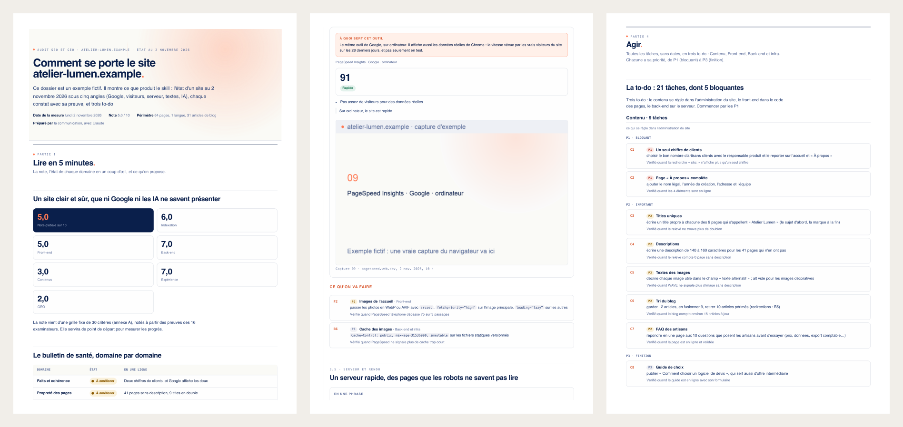

<p align="center"></p>

# audit-seo-geo

**Le skill Claude qui audite n'importe quel site à 360° : ce que Google peut lire, ce que vivent les visiteurs, ce que fait le serveur, ce que disent les textes et ce que répondent les IA. Chaque constat a sa preuve, chaque problème devient une tâche, rangée dans la bonne to-do : contenu, front-end ou back-end.**

[Voir la page du projet](https://tania-bezancon.github.io/audit-seo-geo/) · [Ouvrir un audit d'exemple](https://tania-bezancon.github.io/audit-seo-geo/demo/) · [English summary](#in-english)

---

## Pourquoi un audit de plus

La plupart des audits SEO se ressemblent : un score tiré d'un seul outil, cinquante recommandations génériques, un calendrier que personne ne tient. Trois mois plus tard, on refait l'audit avec un autre outil, la note a changé, et personne ne sait si le site s'est amélioré ou si on a juste mesuré autrement.

Deux questions restent souvent sans réponse :
- **qui doit faire quoi ?** Une liste de 50 points mélange ce que la communication règle en dix minutes dans le CMS et ce qui demande une journée de développeur ;
- **est-ce que les IA nous citent ?** Les acheteurs posent leurs questions à ChatGPT ou à Perplexity avant Google, et beaucoup de sites modernes leur sont invisibles parce que leur texte arrive par JavaScript.

Ce skill répond aux deux.

## Ce qui en fait un audit à 360°

### 1. Cinq regards, 23 examinateurs gratuits
Pas une API payante, pas un score maison opaque : n'importe qui peut refaire la mesure à la même adresse.

| Regard | Ce qu'on vérifie | Avec quoi |
|---|---|---|
| **Google** | robots.txt, sitemap, redirections, fausses 404, canonicals, hreflang, rendu sans JavaScript | relevé automatique, recherche « site: », Bing, test des résultats enrichis, Schema Markup Validator |
| **Visiteurs** | Core Web Vitals, téléphone, accessibilité, appel à l'action, formulaire, preuves | PageSpeed Insights (téléphone et ordinateur), WAVE, validateur W3C |
| **Serveur** | temps de réponse, compression, cache, TLS, en-têtes de sécurité, traceurs | relevé automatique, SSL Labs, Security Headers, Mozilla Observatory, Internet.nl, Webbkoll, Blacklight |
| **Textes** | titles, descriptions, aperçus de partage, fautes, faits contradictoires, fraîcheur | relevé automatique, LanguageTool, OpenGraph.xyz |
| **IA** | qui est cité à votre place, quels faits faux circulent, robots des IA, llms.txt, entité | ChatGPT, Google Mode IA, Brave, Perplexity (sans compte), Wikidata, Ahrefs, Similarweb |

Le relevé automatique (`crawl.py`) lit chaque page comme le fait un robot d'IA, sans JavaScript, et signale les pages presque vides : c'est souvent le problème le plus grave d'un site récent, et aucun outil grand public ne le montre.

### 2. Une note qui se compare
La grille est **fixe** : 6 catégories × 5 critères, chacun noté 0, 1 ou 2. Mêmes outils, mêmes réglages, mêmes questions aux IA à chaque audit. Quand la note bouge, c'est le site qui a bougé, pas la méthode.

| | Catégorie | Ce qu'on regarde |
|---|---|---|
| A | Exploration et indexation | accès des robots, une seule version du site, codes HTTP, rendu sans JavaScript, architecture |
| B | Performance et front-end | LCP, INP et CLS réels, PageSpeed téléphone, images, JavaScript et CSS, mobile |
| C | Serveur, sécurité et vie privée | TLS et HSTS, en-têtes de sécurité, compression et cache, temps de réponse, consentement |
| D | Contenus et SEO éditorial | titles, descriptions et partage, structure, profondeur, justesse des faits, fraîcheur et langues |
| E | Expérience, accessibilité et conversion | les 5 premières secondes, appel à l'action, formulaire, preuves, WCAG |
| F | GEO et autorité | données structurées, robots des IA et llms.txt, entité, contenus citables, présence dans les réponses |

Un critère invérifiable (sans Search Console, par exemple) est noté **NV** et retiré du calcul, au lieu d'être deviné.

### 3. Trois to-do, zéro calendrier
Chaque problème devient une tâche précise, avec la correction et un « Vérifié quand… » que n'importe qui peut refaire. Elle va dans la to-do de la personne qui peut la faire :

- **Contenu** (`C1`, `C2`…) : ce qui se règle dans l'administration du site, sans développeur ;
- **Front-end** (`F1`…) : ce qui se règle dans le code des pages ;
- **Back-end et infra** (`B1`…) : ce qui se règle sur le serveur.

Chaque tâche a sa priorité : **P1** bloquant, **P2** important, **P3** finition. Aucune date, aucun délai, aucun effort en jours. La to-do sort aussi en **Markdown** (à cocher, à coller dans un ticket) et en **CSV** (à importer dans Notion, Jira, Linear, Trello ou GitHub Projects).

La [checklist 360°](references/checklist-360.md) donne, pour plus de 60 contrôles, la preuve attendue, la correction type, la priorité par défaut et le critère touché.

### 4. Le GEO mesuré, pas promis
Le panel IA pose **5 questions fixes** à 4 assistants : 4 questions de marché (celles qu'un acheteur pose sans connaître la marque) et 1 question de marque (« Qu'est-ce que X ? »). On note qui est cité à votre place, et chaque chiffre faux que les IA répètent sur vous. À la remesure, chaque question est posée 3 fois : une citation ne compte que si elle revient 2 fois sur 3.

### 5. Une preuve pour chaque constat
Chaque constat est rangé **vérifié**, **hypothèse** ou **non vérifiable**. Un constat vérifié a sa capture réelle, prise le jour de la mesure, avec un cadre rouge sur le défaut, ou son lien. Aucune statistique inventée, aucune position Google supposée, aucune promesse de classement.

### 6. Un dossier qu'on a envie de lire
Tout part d'un seul fichier, `audit.json`. Les scripts en tirent :
- un **dossier HTML** en 5 parties (lire en 5 minutes, comprendre la mesure, 9 domaines, agir, suivre) et ses annexes ;
- son **PDF A4** et une **page unique** (un seul fichier, captures intégrées, à envoyer par mail) ;
- la **to-do** en Markdown et en CSV ;
- un **PowerPoint 16:9** d'une centaine de slides aux couleurs de la marque.



### 7. Il se contrôle tout seul
Avant de produire quoi que ce soit, `build_dossier.py` s'arrête si une tâche est citée sans exister ou existe sans être citée, si une tâche n'a pas de voie ou de priorité valide, s'il manque un critère, ou **si une note ne correspond pas aux critères** : il recalcule chaque catégorie et la note globale. Il signale aussi tout nom de concurrent resté dans le texte. `scripts/selftest.sh` fabrique l'exemple de bout en bout et vérifie chaque sortie.

### 8. Il respecte les sites qu'il audite
Le relevé laisse 3 secondes entre deux requêtes et reprend là où il s'est arrêté. Le skill ne modifie jamais le site, ne remplit aucun formulaire réel, ne coche jamais une case « je suis humain » et ne capture jamais un espace connecté.

## Installation

```bash
git clone https://github.com/Tania-bezancon/audit-seo-geo.git ~/.claude/skills/audit-seo-geo
cd ~/.claude/skills/audit-seo-geo/scripts && npm install
./selftest.sh
```

Puis, dans Claude Code :

```
/audit-seo-geo https://www.votre-site.fr
```

Le skill se déclenche aussi tout seul quand on demande « un audit SEO », « notre visibilité dans les IA », « la liste des corrections front et back », « refais l'audit pour voir les progrès »…

### Ce qu'il faut sur la machine

| Outil | Pour quoi | Obligatoire |
|---|---|---|
| Python 3.9+ avec Pillow | relevé, fautes, cadres rouges, dossier, to-do | oui |
| Un navigateur piloté par Claude | captures des outils et des IA | oui |
| Node.js 18+ | PowerPoint (pptxgenjs) | pour le PowerPoint |
| Google Chrome ou Chromium | PDF du dossier (`CHROME=/chemin` sinon) | pour le PDF |
| Microsoft PowerPoint ou LibreOffice, PyMuPDF | PDF et planches de contrôle du PowerPoint | non |

## Essayer sans rien auditer

L'exemple fictif d'Atelier Lumen (un site en `.example`, des captures factices) produit tout en quelques secondes :

```bash
cd ~/.claude/skills/audit-seo-geo
scripts/selftest.sh /tmp/audit-exemple
open /tmp/audit-exemple/index.html
```

Ou directement en ligne : [l'audit d'exemple](https://tania-bezancon.github.io/audit-seo-geo/demo/).

## Comment se déroule un audit

Une journée de travail, annoncée au début :

1. **Le contexte** : activité, public, objectif, CMS ou framework, accès disponibles. Rien à redemander pour un site déjà dans `assets/sites.json`.
2. **Les mesures** (environ 3 h) : relevé automatique en arrière-plan, le rendu sans JavaScript, les 19 outils avec leur capture numérotée, le panel des IA, les captures du site, la checklist 360°.
3. **La note** (environ 2 h) : les 30 critères avec leur preuve, les 9 domaines, les tâches des trois to-do.
4. **La fabrication** (environ 1 h) : dossier, PDF, page unique, to-do, PowerPoint, puis contrôle à 1 280 et 375 px et planches du PowerPoint.
5. **Le protocole de remesure** : le seul document daté, pour refaire exactement la même mesure dans 1, 3 ou 6 mois.

## Ce que contient le dépôt

```
SKILL.md                 la méthode : contexte, preuve, mesures, grille, tâches, livrables, contrôles
references/
  checklist-360.md       plus de 60 contrôles, voie par voie, avec correction type et priorité
  outils.md              les 19 outils : adresse, réglage, ce qu'on relève, seuils des feux
  panel-geo.md           les 5 questions et les 4 IA : écrire, poser, noter
  captures.md            ranger, nommer et encadrer les captures
  donnees.md             le format de audit.json
assets/
  defaults.json          grille, voies, priorités, outils, lexique, règles de remesure, domaines
  themes.json            couleurs et police par marque (signature, neutre, les vôtres)
  sites.json             vos sites déjà audités
  exemple/               l'audit fictif d'Atelier Lumen et ses captures
scripts/
  crawl.py               relevé des pages, du serveur et des robots des IA, lent et reprenable
  lt.py                  fautes avec LanguageTool, page par page
  annotate.py            cadres rouges sur une capture
  build_dossier.py       audit.json → HTML, PDF, page unique, to-do .md et .csv (après contrôles)
  build_pptx.js          audit.json → PowerPoint
  render_pptx_pdf.sh     PowerPoint → PDF et planches de contrôle
  selftest.sh            l'exemple de bout en bout
docs/                    la page du projet et la démo en ligne
```

## Ajouter sa marque

Dans `assets/themes.json`, copier le thème `signature`, changer les couleurs, et mettre son nom dans `site.theme` de `audit.json`. Une police sous licence libre va dans `assets/fonts/` (listée dans `font.files`) et sera intégrée à la page unique ; un logo va dans `assets/logos/`. N'ajoutez pas au dépôt une police commerciale ni un logo que vous n'avez pas le droit de diffuser.

## Ce qu'il ne fait pas

- Il ne remplace pas Search Console : sans accès, il le dit dans les limites et en fait une tâche P1.
- Il ne garantit aucun classement ni aucune citation par une IA. Il mesure, il range, il dit quoi corriger.
- Il ne modifie jamais le site audité.
- Le dossier est en français.

---

## In English

`audit-seo-geo` is a [Claude Code skill](https://docs.claude.com/en/docs/claude-code/skills) for 360° website audits, run the same way every time so scores compare across sites and across months.

- **Five angles, 23 free and independent checkers**: what Google can read, what visitors experience, what the server sends, what the copy says, and what AI assistants answer (ChatGPT, Google AI Mode, Brave, Perplexity, queried without an account). The crawler reads every page the way most AI bots do, without JavaScript, and flags pages that are nearly empty without it.
- **A fixed 30-criteria grid** in 6 categories (crawl and indexing, performance and front-end, server and security, content, UX and accessibility, GEO and authority), each scored 0/1/2, unverifiable items excluded rather than guessed. Score out of 10.
- **Three undated to-do lists**: content (CMS), front-end (page code) and back-end (server), each task with a P1 to P3 priority, a precise fix and a "verified when…" check. Exported as Markdown and CSV for Notion, Jira, Linear or GitHub Projects.
- **Proof for every finding**: real screenshots with red boxes, or a link. No invented stats, no ranking promises.
- **One JSON file → HTML report, PDF, single-file page, to-do files and a branded PowerPoint**, with a build step that refuses to run if the scores don't match the criteria or a task is orphaned.

The skill and its reports are in French. Try the [live example report](https://tania-bezancon.github.io/audit-seo-geo/demo/).

## Licence

MIT. Voir [LICENSE](LICENSE). Imaginé par [Tania Bezançon](https://taniabezancon.netlify.app/en).
